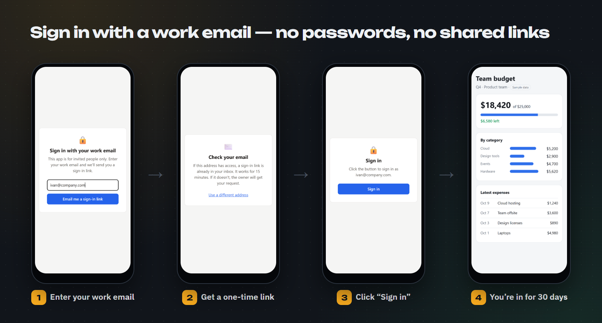
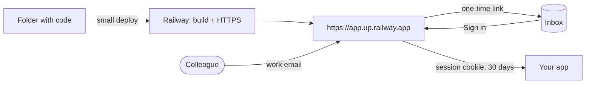

<p align="center">
  
</p>

<p align="center">
  <a href="https://github.com/RuslanKazyradzi13/small-software/actions/workflows/tests.yml"></a>
  <a href="https://pypi.org/project/small-software/"></a>
  
  
  
  <a href="LICENSE"></a>
  
  <a href="README.ru.md"></a>
</p>

<p align="center">
  <b>A cloud for small software.</b><br>
  Ship the tool you built with AI in one command — and share it with your team like a Google Doc.
</p>

---

## Why

An AI agent can write a team tool in an evening: a calculator, a report, a form. Shipping it *safely* is still the
hard part — servers, logins, permissions, a security review. Cloud platforms were designed for software with millions
of users, not for an app that five colleagues open twice a week.

**small** removes that overhead:

- **One command to ship.** `small deploy` packs a folder, builds it on [Railway](https://railway.com) and prints an
  HTTPS URL — about 45 seconds for a small app.
- **Private by default.** Every app starts behind an invite-only login. There is no public URL to leak.
- **Shared like a Google Doc.** `small access add ivan@company.com` — Ivan signs in with his work email. Revoke him
  in seconds; nobody else is affected.

> small follows the idea from Y Combinator's Request for Startups (Fall 2026),
> [“A Cloud for Small Software”](https://www.ycombinator.com/rfs).

> [!NOTE]
> **Beta.** small works end to end and is tested on Windows, macOS and Linux, but it is young: expect rough edges
> and please [open an issue](https://github.com/RuslanKazyradzi13/small-software/issues) when something breaks.
> The CLI, sign-in pages and emails speak English and Russian.

## Quick start

```bash
pip install small-software                      # or: pipx install small-software
export RAILWAY_API_TOKEN=...               # Railway → Account Settings → Tokens

small init team-budget                     # a ready app with invite-only login
cd team-budget
small access add ivan@company.com          # who may sign in (or @company.com for the whole domain)
small mail resend --to you@company.com     # how sign-in emails are sent
small deploy                               # → https://team-budget.up.railway.app
```

<p align="center">
  
</p>

## Share it like a Google Doc

<p align="center">
  
</p>

1. A colleague opens the app and enters a work email.
2. If the address is on the list, a sign-in link arrives. It works **once** and for **15 minutes**.
3. They click **Sign in** and stay signed in for 30 days.

A forwarded link is useless: only the owner of the inbox gets in. An address that is not on the list gets the same
answer — and the owner receives an access request (in the logs and, optionally, in Telegram) with a ready command:
`small access add that@address.com`. Pages and emails switch between English and Russian by browser language.

## What you get

| | |
|---|---|
| **Deploy** | `small deploy` — project, service, build, HTTPS domain and a short `<name>.up.railway.app` address |
| **Access by email** | `small access add ivan@company.com` or `@company.com`; `small access revoke` closes even open sessions |
| **Personal invite links** | `small access add bob` — a token per person, when email is not an option |
| **Sign-in emails** | `small mail resend` (HTTPS, works on Railway Hobby) or `small mail smtp`; a test email is sent before saving |
| **Access requests** | unknown emails become requests; `small notify telegram` forwards them to you |
| **Database** | `small db add postgres` → `DATABASE_URL` in the app; removed together with the app |
| **Sleep** | `small sleep on` — idle apps sleep and cost almost nothing; they wake in ~1.7 s |
| **Dashboard** | `small dashboard` — every app, deploy status, estimated monthly cost, logs, “open as owner” |
| **Custom domain** | `small domain add reports.company.com` — prints the DNS records to add |
| **Templates** | `python-http` (stdlib only), `fastapi`, `node-http`, `streamlit` |
| **Zero dependencies** | the CLI is pure Python standard library; the middleware is a single file for Python and Node.js |

## How it works



The protection lives in [`magic-link`](magic-link/README.md): a WSGI/ASGI middleware for Python (Flask, Django,
FastAPI, Starlette) and a middleware for Node.js (Express, plain `http`). `small init` puts it into every template.

## Security model

- Sign-in links and sessions are signed with HMAC-SHA256 (`SESSION_SECRET`) and scoped by purpose: a link cannot be
  used as a session, and vice versa.
- Links are single-use and expire in 15 minutes. Signing in takes a button press, so corporate mail scanners that open
  links do not burn them.
- The same response for known and unknown addresses; at most 3 emails per address and 10 requests per IP in 15 minutes.
- The link in the email is built from `PUBLIC_URL`, never from the `Host` header, so it cannot be redirected to an
  attacker's domain.
- Removing an address closes its sessions on the next restart — `small access revoke` restarts the app for you.
- Tokens never appear in logs; the local dashboard listens on `127.0.0.1` only and checks the `Host` header.

Report a vulnerability privately — see [SECURITY.md](SECURITY.md).

## Commands

```text
small init [dir] [--template python-http|fastapi|node-http|streamlit]
small deploy [dir] [--name NAME]                 # build and print the URL
small open | link [--as NAME]                    # open the app as the owner / print an invite link
small access [list | add EMAIL|@DOMAIN|NAME | revoke EMAIL|NAME]
small mail [resend | smtp | log | off]           # how sign-in emails are sent
small notify [telegram | off]                    # access requests to Telegram
small env [list | set K=V | unset K]
small db [list | add postgres | remove postgres]
small domain [list | add DOMAIN | remove DOMAIN]
small sleep [on | off]
small logs [-f] [--build]
small dashboard
small destroy                                    # remove the app and its databases
```

## Install

- **Everywhere:** `pip install small-software` (or `pipx install small-software`). Python 3.9+, no dependencies.
- **Windows:** if Smart App Control blocks the unsigned `small.exe` that pip creates, run `python -m small_cli`
  instead, or clone the repo and add its `small-cli` folder to `PATH` — `small.cmd` then serves the command.
- **Language:** English or Russian, picked from your system language. Force one with `SMALL_LANG=en` or `SMALL_LANG=ru`.
- A Railway **account or workspace token** goes to `RAILWAY_API_TOKEN` (a project token cannot create projects).

Full CLI reference: [small-cli/README.md](small-cli/README.md) · [по-русски](small-cli/README.ru.md).

## Roadmap

- [x] One-command deploy, sleep, Postgres, custom domains, dashboard with cost estimate
- [x] Sign-in by work email; personal invite links; access requests to Telegram
- [x] English and Russian: CLI, sign-in pages, emails
- [x] `pip install small-software` from PyPI
- [ ] “Share” button in the dashboard — no terminal needed
- [ ] Email sign-in for the Streamlit template
- [ ] Hosted mode — no Railway account needed
- [ ] Deploy and share straight from AI coding agents (MCP)
- [ ] Company workspace: app catalog, owners, audit log

## Development

```bash
cd small-cli   && python -m unittest discover -s tests     # 120 tests (+ real FastAPI/Streamlit when installed)
cd magic-link  && python -m unittest test_magic_link       # 51 tests
cd magic-link  && node --test                              # 20 tests
```

GitHub Actions runs everything on Windows, macOS and Linux. See [CONTRIBUTING.md](CONTRIBUTING.md) and the
[changelog](small-cli/CHANGELOG.md).

## License

[MIT](LICENSE)
