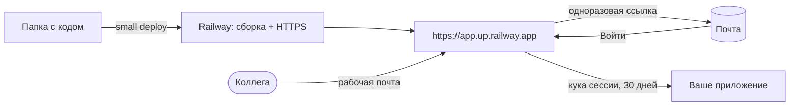

<p align="center">
  
</p>

<p align="center">
  <a href="https://github.com/RuslanKazyradzi13/small-software/actions/workflows/tests.yml"></a>
  <a href="https://pypi.org/project/small-software/"></a>
  
  
  
  <a href="LICENSE"></a>
  
  <a href="README.md"></a>
</p>

<p align="center">
  <b>Облако для маленького софта.</b><br>
  Запустите инструмент, который написали с ИИ, одной командой — и делитесь им с командой, как Google Doc.
</p>

---

## Зачем

ИИ-агент пишет командный инструмент за вечер: калькулятор, отчёт, форму. Сложно другое — *безопасно* им поделиться:
серверы, логины, права доступа, согласование с безопасностью. Облака проектировали для софта на миллионы
пользователей, а не для приложения, которое пять коллег открывают пару раз в неделю.

**small** убирает эту тяжесть:

- **Запуск одной командой.** `small deploy` упаковывает папку, собирает её в [Railway](https://railway.com) и
  печатает адрес с HTTPS — около 45 секунд для небольшого приложения.
- **Закрыто по умолчанию.** Любое приложение сразу за входом для приглашённых. Открытой ссылки, которая утечёт, нет.
- **Доступ — как к Google Doc.** `small access add ivan@company.com` — Иван входит рабочим аккаунтом Google или
  Microsoft либо по одноразовой ссылке на почту. Отозвать — за секунды, остальных это не задевает.

> small развивает идею из Request for Startups Y Combinator (осень 2026)
> [«A Cloud for Small Software»](https://www.ycombinator.com/rfs).

> [!NOTE]
> **Бета.** small работает от начала до конца и проверен на Windows, macOS и Linux, но проект молодой: шероховатости
> возможны. Если что-то сломалось — [откройте issue](https://github.com/RuslanKazyradzi13/small-software/issues).
> CLI, страницы входа и письма — на русском и английском.

## Быстрый старт

```bash
pip install small-software                 # или: pipx install small-software
export RAILWAY_API_TOKEN=...               # Railway → Account Settings → Tokens

small init team-budget                     # готовое приложение со входом для приглашённых
cd team-budget
small deploy                               # → https://team-budget.up.railway.app
small access add @company.com              # кто может войти: один адрес или весь домен
small sso google                           # «Войти через Google» (или: small sso microsoft, small mail resend)
```

<p align="center">
  
</p>

### Или просто попросите ИИ-агента

```bash
claude mcp add small -- small mcp          # Claude Code; Cursor и другие MCP-клиенты — см. справочник
```

> *«Задеплой эту папку и дай доступ ivan@company.com».*

Агент сам создаёт приложение, деплоит его и выдаёт доступ через `small mcp`. Доступ по почте не проводит
секреты через чат, а удаление приложений остаётся только командой в терминале.

## Доступ как к Google Doc

Вы ведёте один список — адреса и целые домены. А подтвердить, что адрес его, человек может удобным для команды
способом:

- **Войти через Google или Microsoft** (`small sso google`, `small sso microsoft`). Аккаунты Google Workspace и
  Gmail; в Microsoft — только сотрудники вашей организации. Почту настраивать не нужно.
- **Одноразовая ссылка на почту** (`small mail resend`). Подходит для любого ящика.

<p align="center">
  
</p>

1. Коллега открывает приложение и входит рабочим аккаунтом — или вводит рабочую почту.
2. Если адрес есть в списке, он внутри (ссылка из письма работает **один раз** и **15 минут**).
3. Браузер помнит вход 30 дней; **«Выйти на всех устройствах»** завершает все входы.

Пересланная ссылка бесполезна: войдёт только тот, кто читает эту почту. Адрес не из списка получает тот же ответ, а
владельцу приходит запрос доступа (в лог и, если подключено, в Telegram) с готовой командой
`small access add адрес`. `small access log` показывает, кто, когда и как входил. Страницы и письма — на русском
или английском, по языку браузера.

## Возможности

| | |
|---|---|
| **Деплой** | `small deploy` — проект, сервис, сборка, HTTPS и короткий адрес `<имя>.up.railway.app` |
| **Доступ по почте** | `small access add ivan@company.com` или `@company.com`; `small access revoke` закрывает даже открытые сессии |
| **Вход через Google / Microsoft** | `small sso google`, `small sso microsoft` — OpenID Connect с PKCE; данные проверяются до сохранения |
| **Личные ссылки** | `small access add bob` — токен на каждого, если почта не вариант |
| **Письма для входа** | `small mail resend` (HTTPS, работает на Railway Hobby) или `small mail smtp`; перед сохранением уходит пробное письмо |
| **Журнал входов** | `small access log` — кто, когда, как и откуда входил, по всем деплоям |
| **Выход везде** | `small access signout ivan@company.com` (или `--all`); с томом человек может сделать это и сам |
| **Постоянный диск** | `small volume add` — файлы переживают деплои; там же хранится состояние входа |
| **Запросы доступа** | незнакомый адрес — это запрос; `small notify telegram` присылает их вам |
| **База данных** | `small db add postgres` → `DATABASE_URL` в приложении; удаляется вместе с приложением |
| **Сон** | `small sleep on` — без запросов приложение спит и почти ничего не стоит, просыпается за ~1,7 с |
| **Дашборд** | `small dashboard` — все приложения, статус деплоя, оценка расхода в месяц, логи, «открыть как владелец» |
| **Доступ без терминала** | кнопка **Поделиться** в дашборде: добавить или отозвать адрес, домен или ссылку |
| **ИИ-агенты (MCP)** | `small mcp` — Claude Code, Cursor и другие агенты создают, деплоят и расшаривают приложения |
| **Свой домен** | `small domain add reports.company.com` — печатает DNS-записи |
| **Шаблоны** | `python-http` (только стандартная библиотека), `fastapi`, `node-http`, `streamlit` |
| **Без зависимостей** | CLI — чистая стандартная библиотека Python; защита — один файл для Python и Node.js |

## Как это устроено



Защита — это [`magic-link`](magic-link/README.md): middleware для Python (WSGI/ASGI: Flask, Django, FastAPI,
Starlette) и Node.js (Express, чистый `http`). `small init` кладёт его в каждый шаблон.

## Безопасность

Обещание small узкое и проверяемое: за страницу входа проходят только адреса из вашего списка. В
[модели угроз](SECURITY.md#threat-model) (на английском) перечислены все защиты, все известные ограничения и то, как
каждая проверяется. Коротко:

- **Закрыто по умолчанию.** Любой запрос — страницы, API, `/docs` — требует действующего входа адреса из списка.
- **Стандартный вход.** Google и Microsoft через OpenID Connect: authorization code flow с PKCE, `state`, привязанный
  к браузеру, `nonce`, проверки получателя, издателя и срока токена. Только адреса, за которые ручается провайдер:
  Google Workspace или Gmail, а в Microsoft — сотрудники вашей организации (без гостей и чужих организаций).
- **Ссылки на почту** подписаны (HMAC-SHA256), одноразовые, живут 15 минут и тратятся только по кнопке, так что
  почтовые сканеры их не сжигают. Известный и незнакомый адрес получают одинаковый ответ; отправка ограничена.
- **Отзыв, который держится.** Убрали адрес — его входы закрыты; `small access signout` закрывает их на всех
  устройствах, не забирая доступ. С томом использованные ссылки остаются использованными и после перезапуска.
- **Секретов нет в логах**, страницы входа нельзя встроить в чужой сайт и запустить на них скрипт, а локальный
  дашборд доступен только с `127.0.0.1`.

Об уязвимости — приватно, см. [SECURITY.md](SECURITY.md).

## Установка

- **Везде:** `pip install small-software` (или `pipx install small-software`). Python 3.9+, без зависимостей.
- **Windows (рекомендуется):** в PowerShell выполните `irm https://raw.githubusercontent.com/RuslanKazyradzi13/small-software/main/install.ps1 | iex`. Установщик ставит small в
  отдельное окружение Python и добавляет команду `small`, которую не блокирует Smart App Control (без
  неподписанного `small.exe`). Нужен Python 3.9+, права администратора не нужны; повторный запуск обновляет small.
- **Язык:** русский или английский — по языку системы. Задать явно: `SMALL_LANG=ru` или `SMALL_LANG=en`.
- В `RAILWAY_API_TOKEN` нужен **токен аккаунта или workspace** (токен проекта не умеет создавать проекты).

Полный справочник команд: [small-cli/README.ru.md](small-cli/README.ru.md) · [in English](small-cli/README.md).

## Планы

- [x] Деплой одной командой, сон, Postgres, свои домены, дашборд с оценкой расхода
- [x] Вход по рабочей почте; личные ссылки; запросы доступа в Telegram
- [x] Русский и английский: CLI, страницы входа, письма
- [x] `pip install small-software` из PyPI
- [x] Кнопка «Поделиться» в дашборде — без терминала
- [x] Вход по почте в шаблоне Streamlit
- [x] Деплой и доступ прямо из ИИ-агентов (MCP)
- [x] Вход через Google и Microsoft; журнал входов; выход на всех устройствах; постоянные тома
- [ ] Защита перед приложением (шлюз) — для любого языка без правок кода
- [ ] Облако без своего аккаунта Railway
- [ ] Пространство компании: каталог приложений, владельцы, общий журнал

## Разработка

```bash
cd small-cli   && python -m unittest discover -s tests     # 180 тестов (+ настоящие FastAPI/Streamlit, если установлены)
cd magic-link  && python -m unittest test_magic_link       # 97 тестов
cd magic-link  && node --test                              # 31 тест
```

GitHub Actions гоняет всё на Windows, macOS и Linux. См. [CONTRIBUTING.md](CONTRIBUTING.md) и
[историю изменений](small-cli/CHANGELOG.md).

## Лицензия

[MIT](LICENSE)
