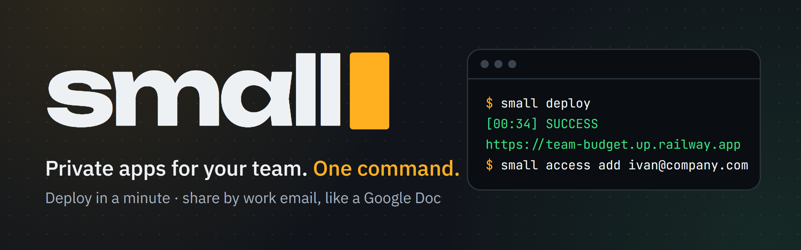
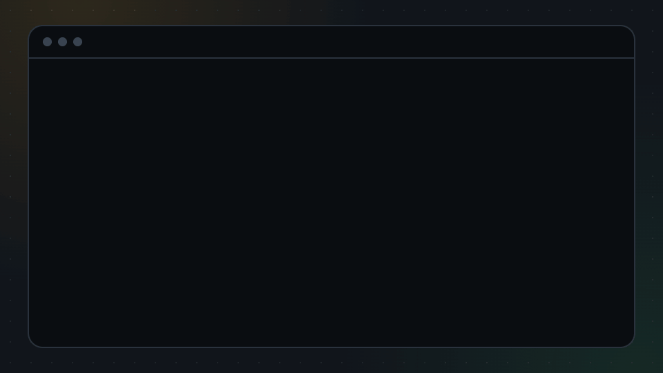
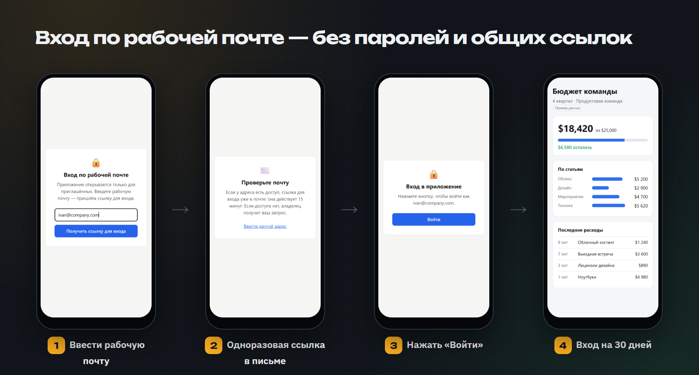

<p align="center">
  
</p>

<p align="center">
  <a href="https://github.com/RuslanKazyradzi13/small-software/actions/workflows/tests.yml"></a>
  <a href="https://pypi.org/project/small-software/"></a>
  
  
  
  <a href="LICENSE"></a>
  
  <a href="README.md"></a>
</p>

<p align="center">
  <b>Облако для маленького софта.</b><br>
  Запустите инструмент, который написали с ИИ, одной командой — и делитесь им с командой, как Google Doc.
</p>

---

## Зачем

ИИ-агент пишет командный инструмент за вечер: калькулятор, отчёт, форму. Сложно другое — *безопасно* им поделиться:
серверы, логины, права доступа, согласование с безопасностью. Облака проектировали для софта на миллионы
пользователей, а не для приложения, которое пять коллег открывают пару раз в неделю.

**small** убирает эту тяжесть:

- **Запуск одной командой.** `small deploy` упаковывает папку, собирает её в [Railway](https://railway.com) и
  печатает адрес с HTTPS — около 45 секунд для небольшого приложения.
- **Закрыто по умолчанию.** Любое приложение сразу за входом для приглашённых. Открытой ссылки, которая утечёт, нет.
- **Доступ — как к Google Doc.** `small access add ivan@company.com` — Иван входит по рабочей почте. Отозвать —
  за секунды, остальных это не задевает.

> small развивает идею из Request for Startups Y Combinator (осень 2026)
> [«A Cloud for Small Software»](https://www.ycombinator.com/rfs).

> [!NOTE]
> **Бета.** small работает от начала до конца и проверен на Windows, macOS и Linux, но проект молодой: шероховатости
> возможны. Если что-то сломалось — [откройте issue](https://github.com/RuslanKazyradzi13/small-software/issues).
> CLI, страницы входа и письма — на русском и английском.

## Быстрый старт

```bash
pip install small-software                      # или: pipx install small-software
export RAILWAY_API_TOKEN=...               # Railway → Account Settings → Tokens

small init team-budget                     # готовое приложение со входом для приглашённых
cd team-budget
small access add ivan@company.com          # кто может войти (или @company.com — весь домен)
small mail resend --to you@company.com     # чем отправлять письма для входа
small deploy                               # → https://team-budget.up.railway.app
```

<p align="center">
  
</p>

## Доступ как к Google Doc

<p align="center">
  
</p>

1. Коллега открывает приложение и вводит рабочую почту.
2. Если адрес есть в списке, приходит ссылка для входа. Она работает **один раз** и **15 минут**.
3. Он нажимает **«Войти»**, и браузер помнит вход 30 дней.

Пересланная ссылка бесполезна: войдёт только тот, кто читает эту почту. Адрес не из списка получает тот же ответ, а
владельцу приходит запрос доступа (в лог и, если подключено, в Telegram) с готовой командой
`small access add адрес`. Страницы и письма — на русском или английском, по языку браузера.

## Возможности

| | |
|---|---|
| **Деплой** | `small deploy` — проект, сервис, сборка, HTTPS и короткий адрес `<имя>.up.railway.app` |
| **Доступ по почте** | `small access add ivan@company.com` или `@company.com`; `small access revoke` закрывает даже открытые сессии |
| **Личные ссылки** | `small access add bob` — токен на каждого, если почта не вариант |
| **Письма для входа** | `small mail resend` (HTTPS, работает на Railway Hobby) или `small mail smtp`; перед сохранением уходит пробное письмо |
| **Запросы доступа** | незнакомый адрес — это запрос; `small notify telegram` присылает их вам |
| **База данных** | `small db add postgres` → `DATABASE_URL` в приложении; удаляется вместе с приложением |
| **Сон** | `small sleep on` — без запросов приложение спит и почти ничего не стоит, просыпается за ~1,7 с |
| **Дашборд** | `small dashboard` — все приложения, статус деплоя, оценка расхода в месяц, логи, «открыть как владелец» |
| **Свой домен** | `small domain add reports.company.com` — печатает DNS-записи |
| **Шаблоны** | `python-http` (только стандартная библиотека), `fastapi`, `node-http`, `streamlit` |
| **Без зависимостей** | CLI — чистая стандартная библиотека Python; защита — один файл для Python и Node.js |

## Как это устроено


Защита — это [`magic-link`](magic-link/README.md): middleware для Python (WSGI/ASGI: Flask, Django, FastAPI,
Starlette) и Node.js (Express, чистый `http`). `small init` кладёт его в каждый шаблон.

## Безопасность

- Ссылки для входа и сессии подписаны HMAC-SHA256 (`SESSION_SECRET`) с разным назначением: ссылку нельзя выдать за
  сессию, и наоборот.
- Ссылка одноразовая и живёт 15 минут. Вход — по кнопке, поэтому почтовые сканеры, открывающие ссылки, её не тратят.
- Одинаковый ответ на известный и незнакомый адрес; не больше 3 писем на адрес и 10 запросов с IP за 15 минут.
- Адрес в письме берётся из `PUBLIC_URL`, а не из заголовка `Host`: перенаправить ссылку на чужой домен нельзя.
- Убрали адрес — его сессии закрываются после перезапуска; `small access revoke` перезапускает сам.
- Токены не попадают в логи; локальный дашборд слушает только `127.0.0.1` и проверяет заголовок `Host`.

Об уязвимости — приватно, см. [SECURITY.md](SECURITY.md).

## Установка

- **Везде:** `pip install small-software` (или `pipx install small-software`). Python 3.9+, без зависимостей.
- **Windows:** если Smart App Control блокирует неподписанный `small.exe`, который создаёт pip, запускайте
  `python -m small_cli` или склонируйте репозиторий и добавьте его папку `small-cli` в `PATH` — команду обслужит `small.cmd`.
- **Язык:** русский или английский — по языку системы. Задать явно: `SMALL_LANG=ru` или `SMALL_LANG=en`.
- В `RAILWAY_API_TOKEN` нужен **токен аккаунта или workspace** (токен проекта не умеет создавать проекты).

Полный справочник команд: [small-cli/README.ru.md](small-cli/README.ru.md) · [in English](small-cli/README.md).

## Планы

- [x] Деплой одной командой, сон, Postgres, свои домены, дашборд с оценкой расхода
- [x] Вход по рабочей почте; личные ссылки; запросы доступа в Telegram
- [x] Русский и английский: CLI, страницы входа, письма
- [x] `pip install small-software` из PyPI
- [ ] Кнопка «Поделиться» в дашборде — без терминала
- [ ] Вход по почте в шаблоне Streamlit
- [ ] Облако без своего аккаунта Railway
- [ ] Деплой и доступ прямо из ИИ-агентов (MCP)
- [ ] Пространство компании: каталог приложений, владельцы, журнал входов

## Разработка

```bash
cd small-cli   && python -m unittest discover -s tests     # 120 тестов (+ настоящие FastAPI/Streamlit, если установлены)
cd magic-link  && python -m unittest test_magic_link       # 51 тест
cd magic-link  && node --test                              # 20 тестов
```

GitHub Actions гоняет всё на Windows, macOS и Linux. См. [CONTRIBUTING.md](CONTRIBUTING.md) и
[историю изменений](small-cli/CHANGELOG.md).

## Лицензия

[MIT](LICENSE)
